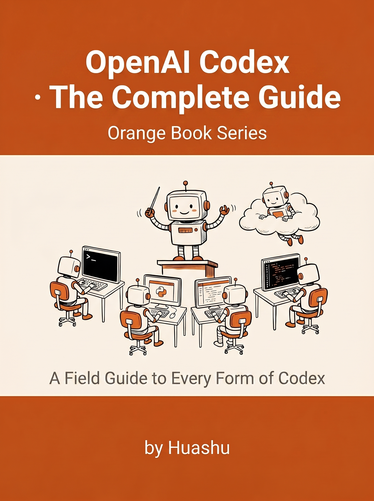
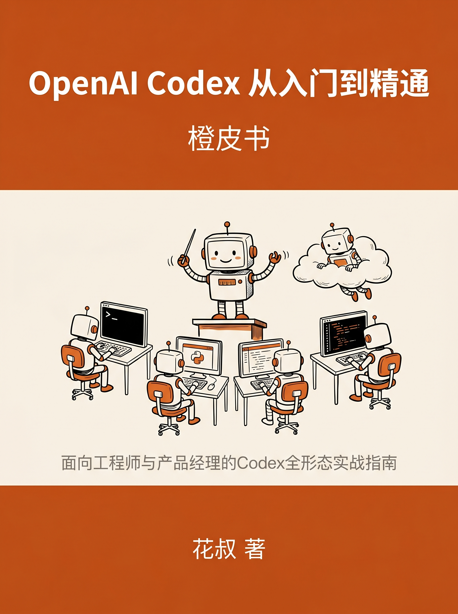

[English README](README.md) | **中文**

  
  &nbsp;&nbsp;
  

  ← <a href="README.md">English edition</a> &nbsp;·&nbsp; <a href="README_zh.md">中文版</a> →

# OpenAI Codex 从入门到精通

> 橙皮书系列 · 花叔 著 · 中文版 v261020（2026 年 10 月）· 英文版 v2.0.1（2026 年 5 月）

OpenAI Codex 的完整实战手册。Codex 现在是一个 ChatGPT 账号、六个入口：CLI、ChatGPT 桌面 App、云端、IDE 扩展、浏览器扩展、手机。中文版 10 月修订基于 Codex CLI 0.163.0 真机实测，配 24 张实测截图，从安装登录到第一个任务一步一图。

作者从未手写过一行代码，却用 AI 做出了 App Store 付费榜第一的产品、出版了 8 本技术书、运营着 30 万粉丝的自媒体矩阵。

## 🎬 15 秒发布视频

  

  <em>使用 OpenAI 官方 VI 系统 · 主角为本书实际封面（AI 生成）· 由 <a href="https://github.com/alchaincyf/huashu-design">Huashu-Design</a> 设计制作</em> 
  <a href="launch-film-zh.mp4">⬇ 下载中文版 1080p MP4</a>
  &nbsp;·&nbsp;
  <a href="launch-film.mp4">English version</a>

## 更新说明

**v261020（2026-10-20，中文版）** — 半年一修：
- **模型整代换了**：GPT-5.5 在 10 月 14 日对 ChatGPT 登录的 Codex 退役，现在是 GPT-6.1 Sol、GPT-6 Astra、GPT-6 Luna
- **产品形态变了**：7 月 9 日 Codex 并进 ChatGPT 桌面 App，Work 和 Codex 共用订阅和用量
- **CLI 真机实测**：本机 0.163.0 跑一遍安装、登录、模型与推理档位、权限预设、斜杠菜单、`/goal`、`/import`、`/usage`，以及一次完整的小任务，24 张截图；`--full-auto`、`--api-key` 已删除，书里给出新写法
- **云端改成可复用环境**，新增网络密钥、GitLab；hooks、插件、定时任务成为正式功能
- **§10 重写**：按 10 月两家官方文档对照 Codex 与 Claude Code 的模型、价格、功能
- **勘误**：5 月版几处写错的地方（Auto-review 数字的出处与含义、Laurenzo 分析的出处、「Anthropic 没做 /goal」等）集中写在卷首「10月补记」
- 桌面 App 和云端这次没有上手实测，相关章节按官方文档整理并已注明

**v2.0.1（2026-05-15）** — 临门补丁：
- 加入 **Codex 手机版** 一节（2026-05-14 发布）：Codex 集成进 ChatGPT 手机端，本质是桌面 Codex App 的远程控制面板。§01、§06、附录 C 都做了对应说明。
- **英文版同步上线**，地道母语行文，不是直译。

**v2.0.0（2026-05-14）** — 一个月迭代之后的大改：
- **GPT-5.5** 空降默认模型：SWE-bench Verified 82.6%、Terminal-Bench 2.0 82.7%、输出 token 降 40%
- **形态从四种变五种**：Codex for Chrome 5 月 7 日上线；桌面 App 一次性放出 Computer Use、In-App Browser、Memory、图像生成和跨天续跑的 Automations
- **Auto-review 改变审批模型**：约 99% 低风险动作自动通过，不再每次打断
- **三档 Pro 定价**（$20 / $100 / $200）取代旧的两档——$100 Pro 是独立开发者的甜蜜点
- **`/goal` 持久化目标系统**：一个目标可以跨 `/clear`、跨 compaction、跨 session 存活

完整 v1 → v2 修订说明见 §00。

## 下载

### 中文版

| 格式 | 文件 | 大小 |
|------|------|------|
| PDF | [**Codex-Complete-Guide-zh-v261020.pdf**](Codex-Complete-Guide-zh-v261020.pdf) | 9.2 MB |
| EPUB（微信读书优化版） | [**Codex-Complete-Guide-zh-v261020.epub**](Codex-Complete-Guide-zh-v261020.epub) | 4.2 MB |
| HTML（单文件，含图） | [**Codex-Complete-Guide-zh-v261020.html**](Codex-Complete-Guide-zh-v261020.html) | 3.7 MB |

### 英文版 (English edition)

英文版仍是 5 月的 v2.0.1，内容停在 GPT-5.5 时代，还没有跟进 10 月修订。

| 格式 | 文件 | 大小 |
|------|------|------|
| PDF | [**Codex-Complete-Guide-en-v2.0.1.pdf**](Codex-Complete-Guide-en-v2.0.1.pdf) | 1.7 MB |
| EPUB | [**Codex-Complete-Guide-en-v2.0.1.epub**](Codex-Complete-Guide-en-v2.0.1.epub) | 5.6 MB |
| HTML（单文件） | [**Codex-Complete-Guide-en-v2.0.1.html**](Codex-Complete-Guide-en-v2.0.1.html) | 232 KB |

> 💡 PDF 文件建议下载后阅读，体验更佳。GitHub 在线预览可能无法完整渲染。

## 本书内容

| 部分 | 章节 | 主题 |
|------|------|------|
| **基础** | §01–§03 | 一个账号，六个入口 · 10 分钟开始用 Codex · 你的第一个任务（真机实测） |
| **日常工作流** | §04–§06 | CLI 深度使用（被删的参数、模型与档位、权限、worktree）· AGENTS.md · 桌面 App 里的 Codex |
| **超出本地机器** | §07–§08 | 云端：可复用环境与网络密钥 · Skills、插件、MCP、hooks、定时任务与 /goal |
| **构建真实产品** | §09–§10 | 从零构建一个完整产品（流程示范）· Codex 和 Claude Code 两个都用时怎么分工 |
| **附录** | A–C | 命令速查（0.163.0 的 56 个斜杠命令）· 定价与套餐（含 Claude 对照）· 常见问题 |

## 适合谁读

- **工程师**：想用 Agent 式编程把效率拉到 10x，把精力从样板代码转移到架构决策
- **Claude Code 用户**：想评估要不要加 Codex，§10 给了基于真实数据的对比与组合建议
- **产品经理与创业者**：想自己做 MVP，Codex 的 Cloud 和 Automations 让一个人同时推多个任务

不需要 AI 编程经验。从零开始，但不在基础概念上磨叽。

## 不回避粗糙之处

- `--full-auto`、`--api-key`、`-a untrusted` 都已删除，照着旧教程敲会直接报错（书里有报错截图和新写法）
- CLI 里 `/import` 按回车就直接导入了，会改 `~/.codex/config.toml`，先备份
- Windows 上 Full Access 删过工作区以外文件的 issue（#18509）到 10 月 20 日仍是 open
- Auto-review 的 99.1% 和 99.3% 有明确口径，OpenAI 自己也说它不能当安全保证

## 橙皮书系列

这是橙皮书系列第 8 本，面向 AI Native Builder 的实战指南：

- Claude Code 从入门到精通
- Claude Code 源码解析
- Harness Engineering
- Agent Skills
- OpenClaw：养一只你自己的 AI
- Hermes Agent
- Polymarket 指南
- **OpenAI Codex 从入门到精通** ← 你在这里

完整合集见 [huasheng.ai/orange-books](https://www.huasheng.ai/orange-books)。

## 关于作者

**花叔（HuaShu）** · AI Native Coder · 独立开发者

小猫补光灯（App Store 付费榜第一）的开发者，8 本橙皮书作者，全平台 30 万+ 粉丝。所有产品全部用 AI 完成，从未手写过一行代码。被 CCTV 与《人民日报》报道为「手搓经济」代表人物。

- X/Twitter：[@AlchainHust](https://x.com/AlchainHust)
- YouTube：[@Alchain](https://www.youtube.com/@Alchain)
- B 站：[花叔v](https://space.bilibili.com/14097567/)
- 微信公众号：花叔
- 官网：[huasheng.ai](https://www.huasheng.ai/)

## 关注花叔

## 📚 在线阅读（WorkBuddy）

本书已同步到 WorkBuddy 资料库：每章一个网页，也可以直接把链接丢给你的 Agent 当上下文。

https://www.workbuddy.cn/space/d/6X9tCSrgcsExJxZV9zSRhS

全部橙皮书入口：https://www.workbuddy.cn/space/d/YcllWXknAUoMk6lFSWdfbI

## 协议

本作品基于 [CC BY-NC-SA 4.0](http://creativecommons.org/licenses/by-nc-sa/4.0/) 协议发布。在保留署名的前提下，可自由分享和改编（非商用）。
